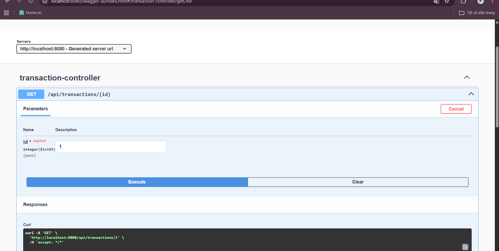

# Expense Tracker API

REST API quan ly thu chi ca nhan, viet bang Java va Spring Boot.

## Tinh nang
- CRUD giao dich thu/chi (them, xem, sua, xoa)
- Loc giao dich theo loai (THU/CHI), danh muc, thang
- Thong ke tong thu, tong chi, so du (toan bo hoac theo thang)
- Kiem tra du lieu dau vao (validation), tra loi loi dang JSON
- Tai lieu API tu dong bang Swagger UI

## Cong nghe
- Java 17, Spring Boot 4.1.1
- Spring Web, Spring Data JPA, Validation
- H2 Database (luu du lieu vao file)
- Maven, Swagger (springdoc-openapi)

## Cach chay
1. Cai JDK 17 tro len
2. Clone repo:
```
   git clone https://github.com/phamha422006/expense-tracker-api.git
   cd expense-tracker-api
```
3. Chay ung dung:
```
   ./mvnw spring-boot:run
```
   (Windows PowerShell: `.\mvnw spring-boot:run`)
4. Mo Swagger UI: http://localhost:8080/swagger-ui.html

## Danh sach endpoint

| Method | Duong dan | Mo ta |
|---|---|---|
| GET | `/api/transactions` | Lay danh sach, loc bang `type`, `category`, `month` (yyyy-MM) |
| GET | `/api/transactions/{id}` | Lay mot giao dich |
| POST | `/api/transactions` | Them giao dich |
| PUT | `/api/transactions/{id}` | Sua giao dich |
| DELETE | `/api/transactions/{id}` | Xoa giao dich |
| GET | `/api/transactions/summary` | Thong ke thu/chi/so du, co the them `month` |

## Vi du

Them giao dich:
```
curl -X POST http://localhost:8080/api/transactions \
  -H "Content-Type: application/json" \
  -d '{"amount":45000,"type":"CHI","category":"An uong","note":"Com trua"}'
```

Thong ke thang 10/2026:
```
GET /api/transactions/summary?month=2026-10
```

## Anh chup man hinh


## Huong phat trien
- Doi `type` thanh enum
- Loc bang truy van database thay vi trong bo nho
- Them dang nhap (Spring Security + JWT)
- Viet unit test bang JUnit
- Chuyen sang MySQL/PostgreSQL va dong goi bang Docker